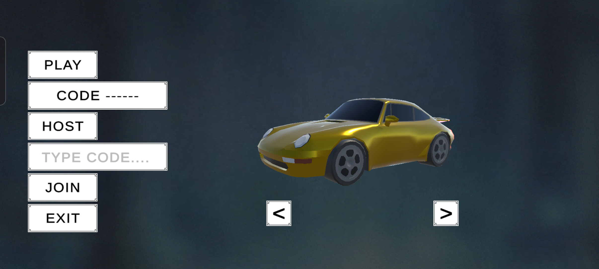
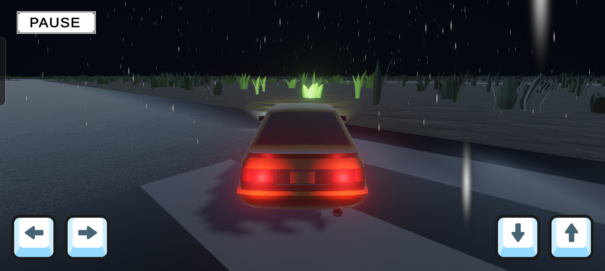

# Poly Clash

This is just something I wanted to do on the side. To understand how hard it is to make a game like that. A full 3D one for mobile with people playing together online.

## 💡 Why I Built This

I have zero background in game development or 3D art but I have always wanted to build a game from the ground up. It was kind of a way to test myself on learning new technical stuff without any prior experience and just pushing through to finish something

Coding alone does not make a game and that became pretty clear once I got into the details. I think dealing with 3D asset pipelines showed me how much more there is to it. That part gave me a lot of respect for technical artists

## 🛠️ What I Used

- **Game Engine:** Unity 6 LTS (URP)
- **Target Platform:** Android
- **Multiplayer / Networking:** Unity Netcode, Relay & Authentication.
- **3D Modeling:** Blender
- **Textures & UI:** [Kenney](https://kenney.nl/), [Poly Haven](https://polyhaven.com/).
- **Car Models:** [Designersoups](https://designersoup.itch.io/designersoups-low-poly-car-pack-vol-2)

## 🚀 Getting Started

1. **Clone the Repo &:**
   - Open the project with **Unity 6 LTS** (with Android Build Support installed).
2. **Switch Platform:**
   - Go to **File → Build Settings** and ensure platform is set to **Android**.
3. **Link Unity Gaming Services (For Multiplayer):**
   - Go to **Edit → Project Settings → Services** and link your Unity Cloud Project ID to enable Relay and Authentication.
4. **Run the Game:**
   - Open `Assets/_Game/Scenes/MainMenu.unity` and press **Play ▶**.
